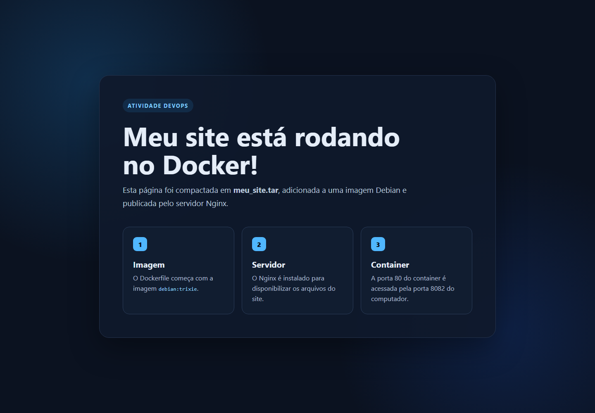

# Evidências da atividade

Validação realizada em 4 de outubro de 2026.

## 1. Configuração da imagem

O build foi executado com:

```powershell
docker build --progress=plain -t meu-site-debian:1.0 .
```

O processo terminou com código `0`. Durante o build, o Docker:

1. baixou a imagem `debian:trixie`;
2. instalou o Nginx;
3. extraiu `meu_site.tar` em `/var/www/html/`;
4. criou a imagem `meu-site-debian:1.0`.

Os dados observados após o build estão em [01-configuracao.txt](01-configuracao.txt).

## 2. Aplicação em execução

O container foi iniciado com:

```powershell
docker run -d --name meu-site-container -p 8082:80 meu-site-debian:1.0
```

A porta `8082` foi usada porque a porta `8080` já estava ocupada por um
processo Java no computador. A validação HTTP retornou status `200` e o título
`Meu site no Docker`.



Os resultados da verificação estão em [03-validacao.txt](03-validacao.txt).
